# Домашнее задание к занятию «Безопасность в облачных провайдерах» - `Гилельс Кирилл`

## Предварительная информация

На VM Ubuntu 24.04 LTS был установлен актуальный Terraform v1.17.1

Яндекс клауд провайдер версии v0.244.0

IP адресс машины 192.168.140.145

Так же был инициализирован гит [репозиторий](https://github.com/olerakon/15.3-clopro-hw.git) проекта 

Для домашнего задания был создан отдельный каталог: `yandex-cloud-hw-prt3` 

В облаке был создан каталог `clopro-hw`, создан сервисный аккаунт `terraform` с правами `editor`. Дря работы с `object storage` сервисному аккаунту была добавлена роль `storge editor` однако ее оказалось недостаточно. Итоговая конфигурация сервисного аккаунта `editor;storage admin`. Для работы с ключами сервисному аккаунту так же была добавлена роль `kms.keys.encrypterDecrypter`. Сгенерирован json ключ и ssh ключ под пользователя для VM. Так же были преобразованы и повторно использованы манифесты из первого дз. 

Сводная информация представлена на скриншоте:

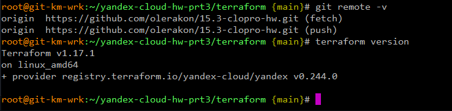

------

## Задание 1. Yandex Cloud   

1. С помощью ключа в KMS необходимо зашифровать содержимое бакета:

 - создать ключ в KMS;
 - с помощью ключа зашифровать содержимое бакета, созданного ранее.
2. (Выполняется не в Terraform)* Создать статический сайт в Object Storage c собственным публичным адресом и сделать доступным по HTTPS:

 - создать сертификат;
 - создать статическую страницу в Object Storage и применить сертификат HTTPS;
 - в качестве результата предоставить скриншот на страницу с сертификатом в заголовке (замочек).

---

## Решение

1. С помощью ключа в KMS необходимо зашифровать содержимое бакета:.

 - создать ключ в KMS;
 - с помощью ключа зашифровать содержимое бакета, созданного ранее.

[kms.tf](terraform/kms.tf):

* `yandex_kms_symmetric_key` с алгоритмом `AES_256` и автоматической ротацией
  раз в год;

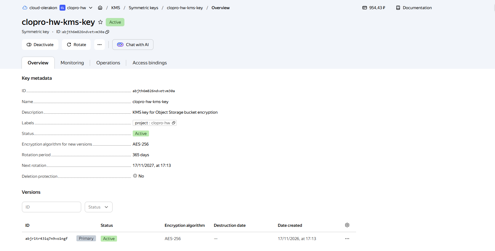

Для шифрования объекта в [storage.tf](terraform/storage.tf) был добавлен блок:

```hcl
  server_side_encryption_configuration {
    rule {
      apply_server_side_encryption_by_default {
        kms_master_key_id = yandex_kms_symmetric_key.bucket_key.id
        sse_algorithm     = "aws:kms"
      }
    }
  }
}
```
Шифрование применяется по умолчанию ко всем объектам, которые попадают в бакет, поэтому у самого yandex_storage_object ключ указывать не нужно — картинка шифруется автоматически.
Включение шифрования в настройках бакета применяется только к новым загружаемым объектам. Файлы, загруженные до активации ключа KMS, останутся незашифрованными и будут подчиняться обычным правилам доступа.

Проверка, что объект действительно зашифрован

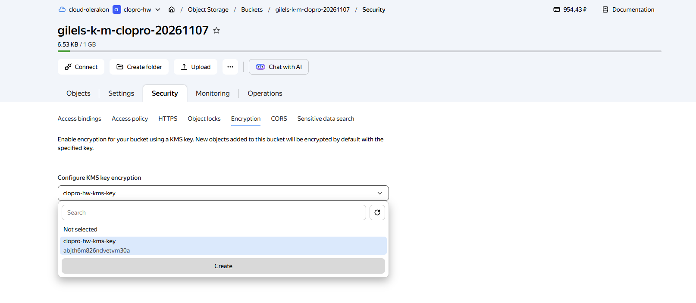

sse_kms_key_id объекта совпадает с идентификатором созданного ключа — файл зашифрован именно им.

При попытке анонимного доступа - сетевая доступность сохраняется, однако при попытке скачать файл, облако возвращает XML Access Denied, что подтверждает что обьект зашифрован.

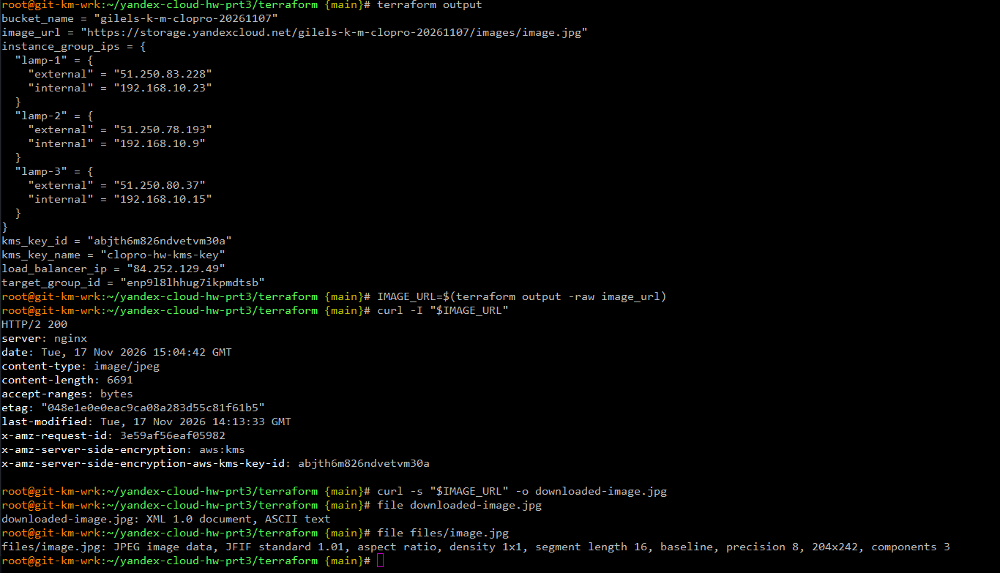

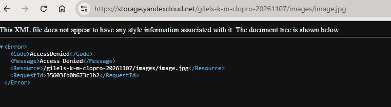

Однако авторизованный доступ к бакету сохраняется в том числе и на скачивание:

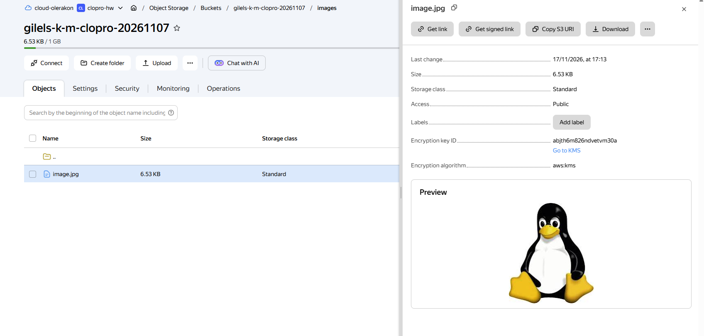

2. (Выполняется не в Terraform)* Создать статический сайт в Object Storage c собственным публичным адресом и сделать доступным по HTTPS:

 - создать сертификат;
 - создать статическую страницу в Object Storage и применить сертификат HTTPS;
 - в качестве результата предоставить скриншот на страницу с сертификатом в заголовке (замочек).

На рег ру был зарегестрирован учебный домен kmgilels.ru

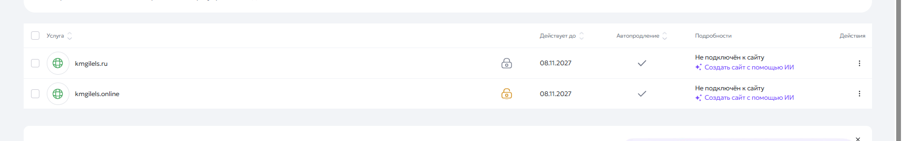

был создан бакет с названием которое будет использоваться как название сайта, загружены простенькие страницы:

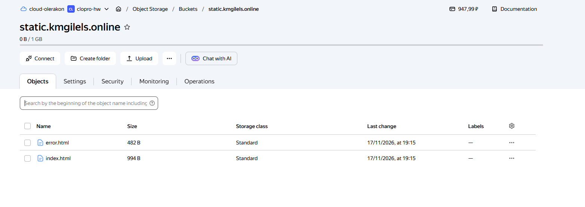

Бакет был переведен в режим вебхостинг и доступен по автогенеренной ссылке от яндекс 

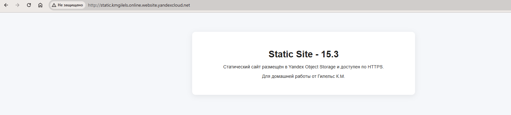

Добавил на хостинге CNAME:

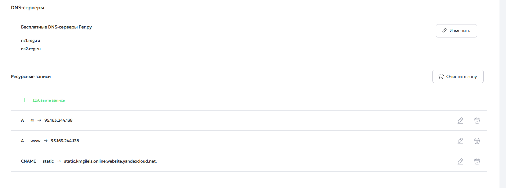

Создал в сертменеджере сертификат:

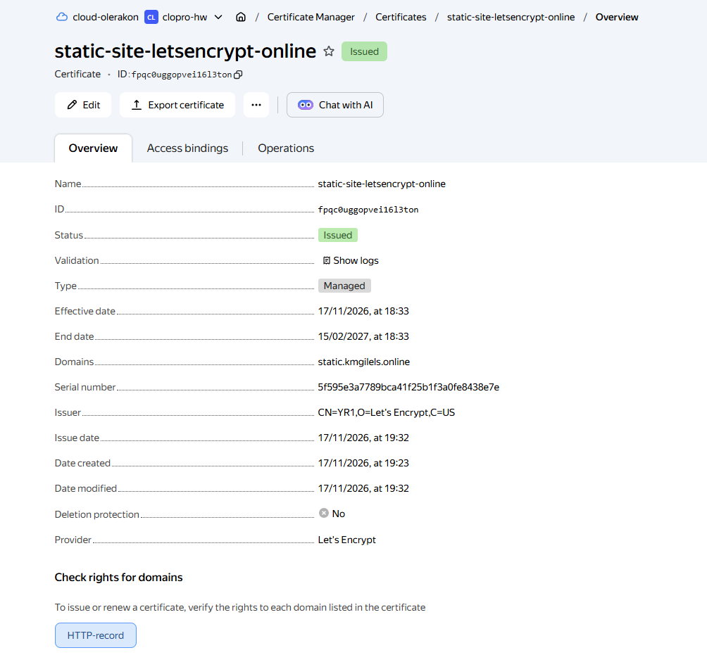

И привязал его к бакету:

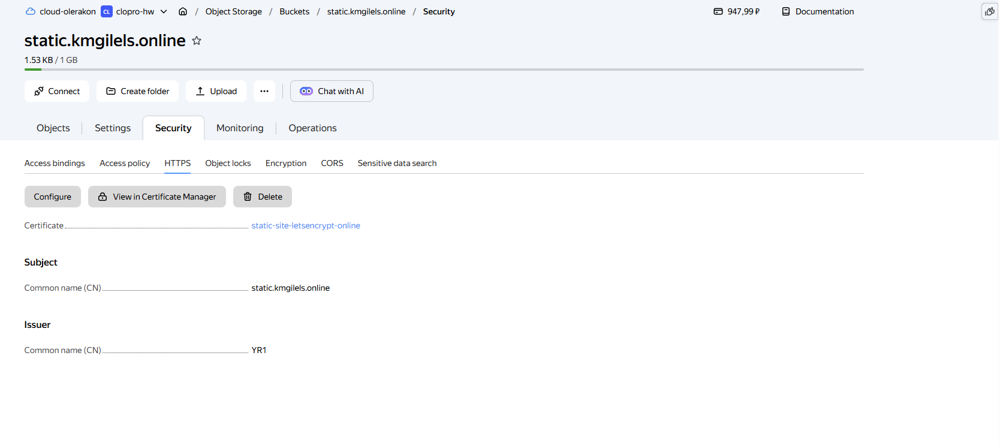

Получил заветную галочку с сертификатом:

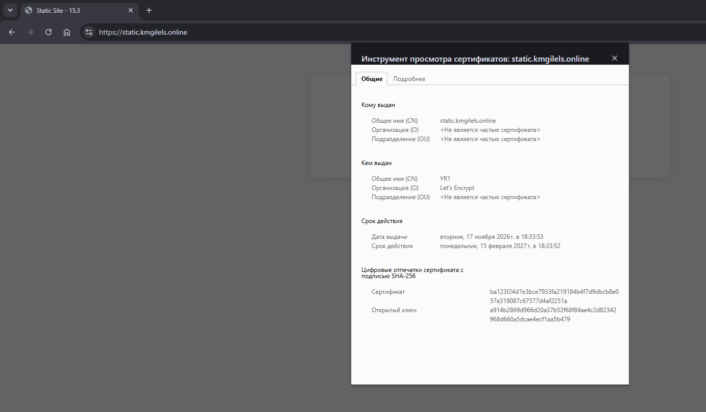

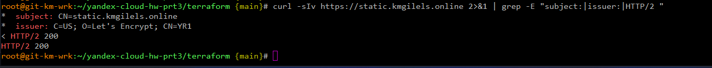

До проверки работы сайт доступен  https://static.kmgilels.online 

---
## Задание 2*. AWS (задание со звёздочкой) - НЕ ВЫПОЛНЯЛОСЬ

Пример bootstrap-скрипта:

```
#!/bin/bash
yum install httpd -y
service httpd start
chkconfig httpd on
cd /var/www/html
echo "<html><h1>My cool web-server</h1></html>" > index.html
aws s3 mb s3://mysuperbacketname2021
aws s3 cp index.html s3://mysuperbacketname2021
```
### Правила приёма работы

Домашняя работа оформляется в своём Git репозитории в файле README.md. Выполненное домашнее задание пришлите ссылкой на .md-файл в вашем репозитории.
Файл README.md должен содержать скриншоты вывода необходимых команд, а также скриншоты результатов.
Репозиторий должен содержать тексты манифестов или ссылки на них в файле README.md.